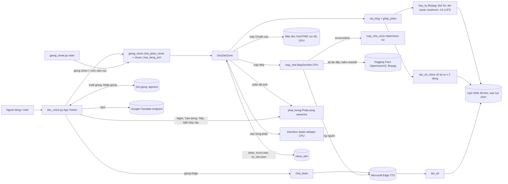

# ARCHITECTURE / Kiến trúc: Đọc Voice (doc-voice)

Tiếng Việt kèm English ở các mục chính.

## 1. Dự án là gì / What it is
- App Windows (Tkinter, đóng gói PyInstaller thành `DocVoice.exe`) chuyển văn bản thành giọng nói, xuất mp3 và srt cho người làm video.
- Windows desktop app (Tkinter, packaged with PyInstaller as `DocVoice.exe`) that turns text into speech and exports mp3 + srt for video makers.
- Hai đường sinh giọng / Two voice paths:
  - **Giọng Edge**: Microsoft Edge Neural qua `edge_tts`, cần mạng, không cần khoá. / Edge neural voices, network required, no API key.
  - **Giọng clone trên máy / On-device clone voice**: giọng **Arthur có sẵn trong app** (chỉ nhúng dấu giọng 1 KB, không kèm mẫu âm thanh) và các giọng do người dùng nhập bằng gói `.dgvoice`. Hai máy đọc / two engines (Arthur chỉ chạy máy Nhẹ / Arthur runs on Light only):
    - **Nhẹ (Light, mọi máy / any PC)**, mặc định: Edge TTS tạo giọng nguồn rồi đổi chất giọng bằng OpenVoice V2 tone color converter chạy onnxruntime trên CPU (`may_nhe.py`, `may_nhe_onnx/`). Không cần GPU. Lần đầu tự tải thêm khoảng 254 MB (model 131 MB từ Hugging Face và công cụ âm thanh), kiểm sha256.
    - **Chuẩn cao (High quality, GPU NVIDIA)**: máy đọc VoxCPM2 chạy cục bộ qua HTTP `127.0.0.1`, dùng nếu máy có sẵn.
  - **Nghe ngay / Instant play**: bấm Nghe hoặc Đọc kịch bản YouTube là phát câu đầu sau khoảng 3 giây, phần sau sinh tiếp trong lúc phát (`phat_luong.py`).
  - **Gói giọng `.dgvoice`**: Xuất giọng, Nhập giọng để chia sẻ giọng giữa những người có quyền dùng giọng đó. / Export and import voice packs between people who hold the rights to that voice.
- Chạy từ mã / Run from source: `python doc_voice.py`. Đóng gói / Build: `powershell -NoProfile -ExecutionPolicy Bypass -File dong-goi.ps1 -ArthurNhung` ra `dist\arthur\DocVoice.exe`.
- Test: `python -m pytest -q kiem_tra_doc_voice.py` (không bật xdist / no xdist).
- App không mở cổng. Máy đọc GPU (nếu có) nghe ở `127.0.0.1`. / The app opens no port.

## 2. Sơ đồ kiến trúc / Architecture diagram

## 3. Quy trình chạy chính / Main flow

Giọng clone / Clone voice:
1. Người dùng chọn ngôn ngữ giọng clone, giọng đã nhập, mức cảm xúc (Tự động theo kịch bản, Trung tính, Kể chuyện, Hào hứng), dán văn bản, bấm Chuyển đổi.
2. `chia_phan_clone` chia đoạn, câu; câu dài cắt ở dấu phẩy gần giữa.
3. Mỗi phần: áp từ điển cách đọc, `chuan_hoa_tieng_anh` (số, năm, %, $, đơn vị, viết tắt), thêm tiền tố cảm xúc, gửi tới máy đọc.
4. `KiemDoc` nghe lại bằng faster-whisper (CPU), tính WER; lệch thì sinh lại tối đa 3 lần, giữ bản tốt nhất.
5. Mỗi phần xong ghi ngay vào `clone_tam/<mã việc>`; bấm Dừng thì dừng sau câu đang đọc, chạy lại thì bỏ qua phần đã có.
6. `cat_lang`, `lam_mem_mep`, `ghep_phan` ghép các phần, chèn lặng giữa câu và giữa đoạn.
7. `hau_ky` (ffmpeg): lọc tiếng ồn thấp, khử ồn nhẹ, de-esser, loudnorm 2 lượt (I=-14, TP=-1.5), ra mp3 320 kbps 48 kHz.
8. `tao_srt_clone` tạo srt từ mốc thời gian thật: tối đa 2 dòng x 42 ký tự.

English: pick a clone voice and emotion level, paste text, press Convert. Text is split into sentences, normalised, synthesised, re-checked with a local speech recogniser (WER), stitched with natural pauses, mastered to -14 LUFS, and exported as mp3 plus srt.

Nghe ngay / Instant play: `tach_chuong` lọc ghi chú và lấy tiêu đề làm chapters; `DocDaiClone.chay` sinh trước câu đang nghe; `PhatLuong` phát qua waveOut, có đệm thích ứng khi máy bận; sinh đủ thì xuất file ngay.

Giọng Edge / Edge voices: chia đoạn 2.500 ký tự, gửi song song `edge_tts`, ghép mp3, srt theo SentenceBoundary.

Phát hành và cập nhật / Release and update: chi tiết trong `docs/PHAT-HANH.md`. Bản đăng công khai luôn là bản Arthur nhúng dấu giọng (`-ArthurNhung`), không kèm mẫu âm thanh; `quet-ban-team.ps1` quét chặn. Tự cập nhật chỉ thay file exe, không đè cài đặt của người dùng ở `%APPDATA%\DocVoice`.

## 4. Bảng thành phần / Components
| Tên / Name | File | Việc / Role |
|---|---|---|
| App | `doc_voice.py` | Giao diện, chọn giọng, cảm xúc, điều phối Edge hoặc clone, cài đặt, tự cập nhật / UI and orchestration |
| Giọng clone | `giong_clone.py` | Chuẩn hoá tiếng Anh, chia phần, gọi máy đọc, kiểm whisper, ghép, hậu kỳ, srt, dòng lệnh / Clone pipeline and CLI |
| Máy đọc nhẹ | `may_nhe.py`, `may_nhe_onnx/` | Edge + OpenVoice V2 ONNX trên CPU / CPU engine |
| Phát luồng | `phat_luong.py` | waveOut qua ctypes, phát trong lúc sinh, tạm dừng, nhảy câu, đệm thích ứng / Streaming playback |
| Kiểm chất lượng | `kiem_chat_luong.py`, `cai-kiem-sau.ps1` | Chấm ĐẠT hoặc KHÔNG ĐẠT từng bản đọc: mất tiếng, im bất thường, lặp, thiếu từ, click chỗ ghép, sai giọng từng câu; tự đọc lại phần lỗi; báo cáo json và html; nút Chạy nhiều kịch bản. `cai-kiem-sau.ps1` cài tầng nghe lại (faster-whisper) / Quality check per take |
| Kiểm kịch bản | `kich_ban_kiem.py` | Trước khi đọc: báo câu quá dài, ký hiệu lạ, số điện thoại, ngày, giờ, viết tắt dễ đọc sai và gợi ý sửa / Script pre-check |
| Máy đọc GPU riêng | `may_doc_clone.py` | Chế độ Chuẩn cao (VoxCPM2 trên GPU NVIDIA) khi máy có sẵn môi trường; bản phát hành dùng chế độ Nhẹ / Optional GPU engine |
| Test | `kiem_tra_doc_voice.py` | Test hàm chuẩn hoá, giọng clone, gói giọng, máy nhẹ, nghe luồng, tự cập nhật / Tests |
| Đóng gói | `dong-goi.ps1`, `requirements.txt` | PyInstaller onefile; `-ArthurNhung` ra bản phát hành và quét chặn / Packaging |
| Quét bản phát hành | `quet-ban-team.ps1` | Chặn mẫu giọng lọt vào bản đăng công khai / Release safety scan |
| Phát hành | `phat-hanh.ps1`, `docs/PHAT-HANH.md`, `docs/RELEASE-v1.5.0.md` | Quy trình phát hành một lệnh, ghi chú song ngữ / Release flow |
| Bộ cập nhật bản cũ | `docs/cap-nhat-cu/` | Hàm tự cập nhật của bản cũ, dùng cho test mô phỏng / Old updater snapshots for tests |

## 5. Dữ liệu và tích hợp / Data and integrations
- Cài đặt / Settings: `cai_dat.json` (chạy mã: thư mục app; exe: `%APPDATA%\DocVoice`).
- Thư mục tạm clone: `%APPDATA%\DocVoice\clone_tam\<mã việc>\`; có thể xoá khi không cần chạy tiếp.
- Model máy Nhẹ / Light engine model: `%LOCALAPPDATA%\DocVoice\may_nhe\` (OpenVoice V2, MIT, Hugging Face), ffmpeg LGPL ghim đúng một bản, kiểm sha256.
- Giọng Arthur (giọng mặc định đi kèm app): dấu giọng 1 KB `giong_nhung/arthur/se.npy` nằm trong kho (từ 1.6.0) và trong exe, không thể khôi phục âm thanh từ đó; mẫu âm thanh không đưa lên. / Arthur (default voice shipped with the app): a 1 KB voice fingerprint in the repo (since 1.6.0) and inside the exe; no audio can be recovered from it.
- Giọng người dùng nhập / Imported voices: `%APPDATA%\DocVoice\giong_clone\<tên>\`, gói phải ghi rõ quyền sử dụng.
- Tích hợp / Integrations: Edge TTS, Google Translate endpoint, Hugging Face (tải model), ffmpeg, faster-whisper (tuỳ chọn).
- Không dùng API trả phí, không đọc khoá hay token nào. / No paid API, no keys or tokens read.

## 6. Lỗi và rủi ro đã biết / Known limits
- Tốc độ phụ thuộc máy: máy yếu hoặc đang bận thì sinh chậm hơn thời gian thực, nghe ngay sẽ có chỗ chờ. / Speed depends on the PC; on a busy or weak CPU instant play may pause.
- Chế độ Nhẹ cần mạng (Edge TTS). Mất mạng giữa chừng thì câu đó lỗi, bấm lại thì đọc tiếp. / Light engine needs network.
- Bản 1.0.0 (Đọc Giọng) không tự cập nhật được, cần tải tay. / v1.0.0 cannot auto-update; download manually.
- Chỉ nhập và dùng giọng khi bạn có quyền hợp pháp với giọng đó. / Only use voices you are legally allowed to use.
- Exe chưa ký số nên Windows SmartScreen có thể cảnh báo. / The exe is unsigned; SmartScreen may warn.
- Proxy: app mở từ tiến trình có `HTTPS_PROXY` trỏ về `127.0.0.1` mà cổng đã chết thì trước 1.6.0 ô Ngôn ngữ, ô Giọng trống. Từ 1.6.0 `ap_proxy_cho_app()` bỏ proxy máy này đã chết lúc mở, giữ proxy còn sống và proxy ở máy khác, và Arthur luôn được nạp trước danh sách Edge. / A dead local proxy no longer empties the voice list; Arthur is always loaded first.

## 7. Phiên bản / Versions
| Bản / Version | Nội dung / Changes |
|---|---|
| 1.5.0 | Chế độ Nhẹ trên CPU, gói giọng `.dgvoice`, Đọc kịch bản YouTube một nút, nghe ngay, mức cảm xúc Tự động theo kịch bản, bản Arthur có sẵn (nhúng dấu giọng, không mẫu âm thanh), tự cập nhật giữ lựa chọn người dùng. / CPU Light engine, voice packs, one-button YouTube script reading, instant play, auto emotion level, Arthur built in as a voice fingerprint, no audio sample. |
| 1.6.0 | Kiểm chất lượng bản đọc và Chạy nhiều kịch bản, Kiểm kịch bản trước khi đọc, chuẩn hoá số, giờ, ngày, điện thoại, đọc lại phần lỗi bằng biến thể, tiến độ khi đọc, Arthur luôn có sẵn kể cả khi mạng hay proxy lỗi, bỏ proxy máy này đã chết, dấu giọng Arthur nằm trong kho. / Quality check and batch scripts, script pre-check, better number and time normalisation, retry with variations, progress line, Arthur always available even when network or proxy fails, dead local proxy cleanup, Arthur fingerprint in the repo. |
